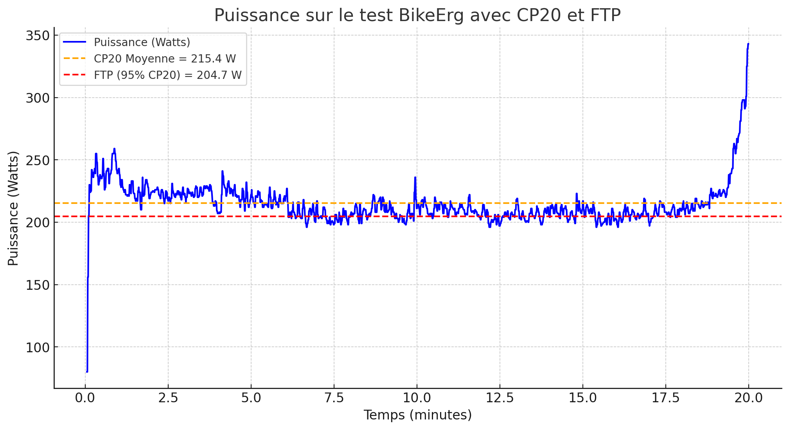
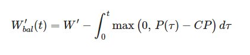
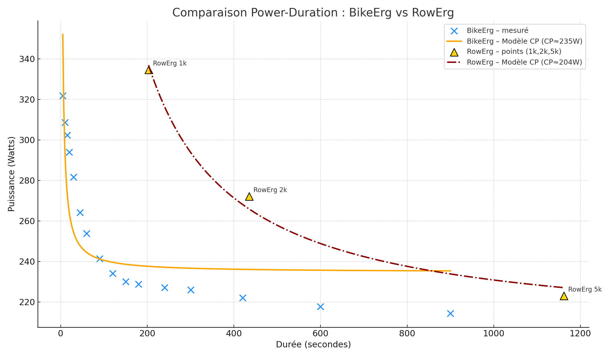
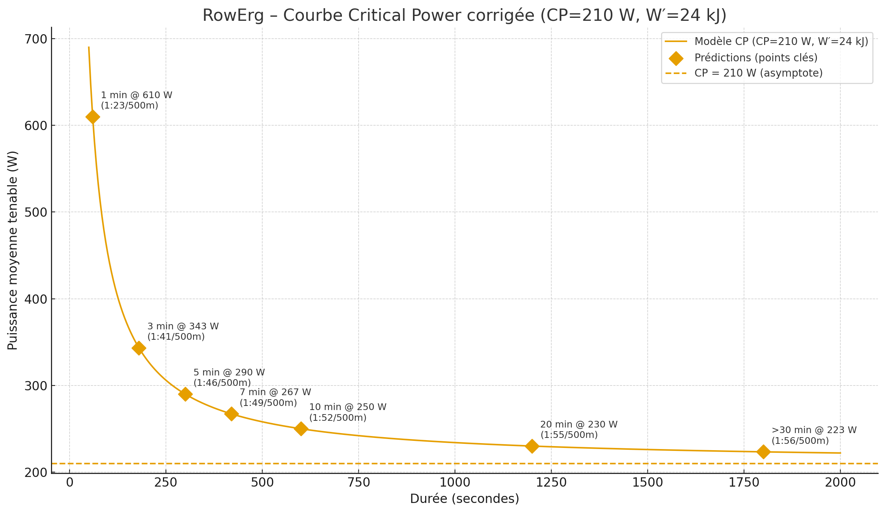

# Introduction

En CrossFit, on se pose souvent la question de la gestion de notre allure, du **pacing** sur un WOD avec ergomètres : rameur, Assault Bike, SkiErg… La gestion de l'allure est déterminante pour performer.

👉 Par exemple, gagner seulement **2 secondes sur un split de 500 m au rameur** peut paraître intéressant, mais le coût énergétique est colossal. On risque de brûler une grande partie de nos réserves pour un gain minime… qu'on reperdra ensuite dans les transitions pendant le WOD.

À l'inverse, si la suite du WOD est particulièrement "taxing" — gros volume de thrusters, de gymnastics ou sur l'une de nos faiblesses — on a tout intérêt à **lever un peu le pied sur l'ergo** afin de garder du jus pour attaquer le reste plus efficacement.

Enfin sur les formats de type **sprint max calories Echo Bike** : dans ce cas, savoir **quelle puissance on peut réellement soutenir** sur une durée donnée devient essentiel pour maintenir un rythme constant et éviter d'exploser en plein milieu.

👉 Au final, **mieux se connaître et adapter son pacing** apparaît comme un pilier pour tout athlète qui vise à optimiser sa performance en compétition comme à l'entraînement.

---

  <h3 style="margin-top:0; margin-bottom:0.5rem;">Ne ratez plus aucune nouveauté 👋</h3>
  

    Abonnez-vous à la newsletter pour recevoir les prochains articles directement dans votre boîte mail.
  

  <iframe data-tally-src="https://tally.so/embed/3yVAz8?hideTitle=1&transparentBackground=1&dynamicHeight=1"
          loading="lazy"
          width="100%"
          height="150"
          frameborder="0"
          marginheight="0"
          marginwidth="0"
          title="Newsletter form"></iframe>
  

  

    Pour en savoir plus sur nos pratiques en matière de confidentialité et notre engagement à protéger vos données personnelles,
    consultez notre <a href="/privacy/" target="_blank" style="color:#007acc; text-decoration:none;">Politique de confidentialité</a>.
  

---

# 1. Les Fondamentaux Physiologiques

On comprend donc que le pacing ne peut pas être laissé au hasard.
Pour prendre les bonnes décisions pendant un WOD, il faut s'appuyer sur des repères objectifs, en plus de nos sensations.

C'est là qu'entrent en jeu trois notions clés, couramment utilisées dans les sports d'endurance :

- la **fréquence cardiaque (FC)**,
- la **FTP (Functional Threshold Power)**,
- et la **CP20 (Critical Power 20 minutes)**.

Avant de voir comment les appliquer concrètement en CrossFit, prenons le temps de poser les bases et de comprendre ce que ces concepts signifient vraiment d'un point de vue physiologique.

## 1.1 Les Trois Concepts Clés

### Fréquence Cardiaque (FC)

La **fréquence cardiaque** (FC) est le nombre de battements de ton cœur par minute (bpm).

- Elle permet de suivre l'intensité de l'effort.
- On distingue la **FC au repos**, la **FC maximale** et les **zones de FC** (Z1 à Z5) qui servent à calibrer l'entraînement (endurance, seuil, haute intensité).

### FTP (Functional Threshold Power)

La **FTP** est la puissance moyenne maximale que tu peux maintenir de façon stable pendant environ **1 heure**.

- Elle est mesurée en watts.
- C'est une référence pour définir les **zones d'entraînement** en cyclisme, rameur ou Assault Bike.

### CP20 (Critical Power 20 minutes)

La **CP20** est la puissance moyenne maximale que tu peux soutenir pendant **20 minutes**.

- C'est un test de performance brute, sans conversion.
- Elle est souvent utilisée comme base pour estimer la **FTP** (95 % de la CP20 ≈ FTP).
- Plus "courte" que la FTP, elle est plus facile à tester régulièrement.

## 1.2 Réaliser Votre Test CP20

### Le protocole

1. Choisis un ergomètre (BikeErg, RowErg, SkiErg)
	👉 En pratique, le **BikeErg** est souvent privilégié car il minimise la part technique (plus simple de pédaler que de maintenir une technique parfaite au rameur).
2. Tiens **20 minutes d'effort maximal et constant**
3. Note ta **puissance moyenne (en W)** → c'est ta **CP20**
4. Calcule ta **FTP = 0,95 × CP20**

> Pour les perfectionnistes, on peut réaliser un **test CP20 spécifique à chaque machine** afin d'obtenir une table de référence adaptée à chaque ergo.

### Mon exemple : BikeErg juillet 2024

> ⚠️ **Ces données sont personnelles**
> Voici la courbe de puissance obtenue lors de **mon** test CP20 (juillet 2024 sur BikeErg).
> Les valeurs présentées ci-dessous ne sont valables **que pour moi**. Vous devez réaliser vos propres tests pour obtenir des données exploitables.

Sur cette base, on calcule :

- **CP20 = 215 W**
- **FTP ≈ 205 W (95 % CP20)**

## 1.3 Définir Vos Zones d'Entraînement

Une fois que l'on a défini ses **zones de puissance** (ou de fréquence cardiaque), on peut commencer à les utiliser pour **calibrer son effort** pendant un WOD.

Les études en physiologie de l'endurance montrent qu'à chaque zone correspond un **temps soutenable maximal** avant que la performance ne s'effondre.
👉 Autrement dit : plus tu montes dans les zones, plus la durée pendant laquelle tu peux tenir cette intensité diminue.

> 🔍 En CrossFit, la majorité des WODs se situent **entre 5 et 20 minutes** d'effort effectif.
> On évolue donc principalement dans les **zones Z5 à Z7**, c'est-à-dire autour du **seuil lactique** et de la **capacité anaérobie**.

> ⚠️ **Important : Valeurs personnelles**
> Les valeurs ci-dessous (splits et calories) correspondent à **mon profil personnel** basé sur ma FTP de 205 W.
> Pour utiliser ce tableau efficacement, vous devez d'abord **réaliser vos propres tests** (CP20 ou FTP) et recalculer les splits correspondant à vos zones.

| Zone   | % FTP     | Row/Ski (split/500m) | Bike (split/1000m) | Echo Bike (Cal/min) | Temps soutenable |
| ------ | --------- | -------------------- | ------------------ | ------------------- | ---------------- |
| **Z1** | ≤ 55 %    | 2:26 – 9:15          | 2:26 – 9:15        | 2–5                 | Plusieurs heures |
| **Z2** | 56–75 %   | 2:11 – 2:25          | 2:11 – 2:25        | 5–7                 | 1.5–4 h          |
| **Z3** | 76–90 %   | 2:04 – 2:11          | 2:04 – 2:11        | 7–9                 | 30–90 min        |
| **Z4** | 91–105 %  | 1:58 – 2:04          | 1:58 – 2:04        | 9–11                | 40–70 min (~FTP) |
| **Z5** | 106–120 % | 1:53 – 1:57          | 1:53 – 1:57        | 11–13               | 4–8 min          |
| **Z6** | 121–150 % | 1:44 – 1:52          | 1:44 – 1:52        | 13–16               | 30 s – 2 min     |
| **Z7** | > 150 %   | 1:35 – 1:43          | 1:35 – 1:43        | 16–20+              | 5–20 s           |

### Application WOD : Rameur 12 minutes

Prenons un athlète avec une **FTP de 200 W** sur rameur.

#### 🔸 Scénario 1 – WOD "léger" sur la partie gymnique

> (ex. _Row + Burpees + Air Squats_)

Tu peux te permettre un **pacing plus haut**, autour du milieu de **Z5**, soit environ **1:57/500 m**.
Tu iras chercher une bonne intensité sans risquer de compromettre les mouvements suivants.

#### 🔸 Scénario 2 – WOD "taxant" musculairement

> (ex. _Row + Thrusters + Toes-to-Bar_)

Ici, l'objectif est de **préserver ton système anaérobie** pour les transitions.
Tu restes donc plutôt sur une intensité **proche de Z4 haute**, autour de **2:00 à 2:03/500 m**.
Tu perds 15–20 secondes sur le row, mais tu restes capable d'enchaîner efficacement sur les mouvements lourds.

### Les limites du zonage classique

Le **zonage d'entraînement** (Z1 à Z7) est un excellent outil pour apprendre à calibrer son effort.
Mais dès qu'on parle de **performance compétitive**, ce découpage devient **trop approximatif**.

Chaque zone couvre une **large plage d'intensité**.
Par exemple, la zone 5 s'étend de **106 à 120 % de FTP**, soit une différence de presque **15 % de puissance** entre le bas et le haut de la zone.
👉 Pourtant, sur le terrain, cette différence change tout :
tu peux tenir 8 minutes à 105 %, mais à 120 %, tu exploses en moins de 3.

C'est un peu comme dire à un pilote de Formule 1 de "rester entre 200 et 300 km/h" :
utile pour situer le type d'effort, mais insuffisant pour **optimiser le virage**.

---

# 2. Aller Plus Loin avec le Modèle Critical Power (CP/W′)

En compétition, les marges sont faibles :
gagner **2 secondes sur un split rameur**, ou **maintenir 10 W de plus** sur un BikeErg peut faire la différence entre un top 10 et un top 3.

Pour ajuster à ce niveau de précision, il faut **modéliser la relation continue entre puissance et durée** plutôt que de raisonner par zones.

C'est exactement ce que permet le modèle **Critical Power (CP)** :

- il relie **chaque durée d'effort à la puissance soutenable maximale**,
- il permet de **prédire ton temps de maintien** à une intensité donnée,
- et donc d'établir un **pacing ultra-personnalisé** selon la durée du WOD.

Le modèle CP repose sur deux composantes :

| Variable                | Signification                       | Interprétation simplifiée                                               |
| ----------------------- | ----------------------------------- | ----------------------------------------------------------------------- |
| **CP (Critical Power)** | Puissance critique                  | Ton "seuil aérobie durable" — ce que tu peux tenir longtemps            |
| **W′ (W prime)**        | Capacité de travail au-dessus de CP | Ton "réservoir anaérobie" — énergie disponible pour les phases intenses |

## 2.1 Comprendre le Modèle

### La logique énergétique

- Si tu travailles **au-dessus de CP**, tu consommes progressivement ton **réservoir W′**.
    → Tu te fatigues vite, mais tu vas vite.
- Si tu travailles **en dessous de CP**, tu le **recharges lentement**.
    → Tu tiens la distance, mais sans explosivité.

Cette approche traduit en chiffres la réalité physiologique entre les deux filières :

| Filière                        | Description                                             | Exemple typique                               |
| ------------------------------ | ------------------------------------------------------- | --------------------------------------------- |
| **Aérobie ("avec oxygène")**   | Effort modéré, durable, basé sur l'oxygène.             | Jogging, WOD long type "Murph"                |
| **Anaérobie ("sans oxygène")** | Effort intense, court, sans apport d'oxygène suffisant. | Sprint max cal Echo Bike, fin de WOD for time |

### Formule de Skiba (2012)

Cette équation formalise l'évolution de ton réservoir énergétique :

**Interprétation en français :**

Cette formule calcule le **W' restant** (ton réservoir anaérobie disponible) à chaque instant :

- **W'(t)** = énergie anaérobie encore disponible au temps t
- **W'** = capacité totale de ton réservoir (déterminée par tes tests)
- **∫(P-CP)dt** = énergie dépensée au-dessus de CP (quand tu pousses fort)
- **e^(-Δt/τ)** = terme de récupération qui modélise comment ton W' se recharge pendant les phases sous CP

👉 **En pratique** : si tu pousses à 300 W alors que ta CP est à 220 W, tu consommes (300-220) = 80 W de ton réservoir W' chaque seconde. Si ensuite tu redescends sous CP, le réservoir se recharge progressivement selon une constante de temps τ (tau).

À toi de jouer : choisis une puissance moyenne pour 12 minutes d'effort et regarde quand ton réservoir se vide. Essaie aussi l'alternance, même moyenne mais en alternant plus fort et moins fort chaque minute.

<noscript>
Ce simulateur de réservoir W′ demande JavaScript.
</noscript>

## 2.2 Construire Votre Courbe Puissance-Durée

### Protocole de test

Se baser uniquement sur un test CP20 donne une bonne estimation du seuil, mais c'est trop réducteur.
En réalité, la relation entre puissance et durée n'est pas linéaire :
on ne produit pas la même puissance sur 1 minute, 5 minutes ou 20 minutes — et chaque durée sollicite des filières énergétiques différentes.

👉 Pour modéliser finement ton profil, il faut donc plusieurs points de mesure :
au minimum 3 efforts maximaux répartis entre 1 et 20 minutes (ex. : 1 min / 5 min / 20 min).
Ces valeurs servent à ajuster la courbe CP/W′ et refléter ta physiologie réelle.

### Mon exemple : BikeErg vs RowErg

Dans mon cas, j'ai choisi de tracer deux courbes pour l'exemple, et qui démontre qu'on délivre des niveaux de puissance différents entre les ergos :

- une pour le **BikeErg**, construite à partir de mon test CP20,
- et une pour le **RowErg**, calculée à partir de mes chronos sur 1000 m, 2000 m et 5000 m.

On observe immédiatement que les deux graphes sont différents, avec de meilleurs résultats sur le rameur. Rien d'étonnant : à cette époque, je sortais d'un cycle spécifique rameur, alors que je n'avais pas touché un vélo depuis longtemps. Mon corps était donc beaucoup plus "calibré" et efficace sur cet ergomètre : je peux soutenir des puissances plus importantes plus longtemps sur le rameur que sur le vélo.

Tracer et comparer ces courbes pour différents ergos est intéressant car cela permet de :

- suivre **l'évolution et la progression** sur un ergomètre donné,
- mettre en évidence les **écarts entre ergos** pour un même athlète,
- identifier les **points faibles** : un trop grand déficit sur un ergo peut indiquer un manque technique ou un besoin de planification d'un cycle dédié.

En pratique, cela aide l'athlète (et son coach) à devenir plus homogène et plus complet, un atout essentiel quand la compétition peut mobiliser n'importe lequel des ergos.

### Interprétation de la courbe

Si on prend ma courbe rameur, on retrouve :
- **CP (Critical Power)** = 220W — mon "seuil aérobie", l'intensité que tu peux tenir quasi-indéfiniment
- **W'** (W-prime) = 27 kJ — ma "batterie anaérobie", l'énergie disponible au-dessus de CP

Grâce à ce modèle, on peut **prédire la puissance soutenable pour n'importe quelle durée**

### Rappel des prédictions rameur (arrondies)

> 📊 **Exemple basé sur mes données personnelles (CP = 220 W, W' = 27 kJ)**

- **1 min** → **610 W** (~**1:23**/500 m) — _sprint max cal_
- **3 min** → **343 W** (~**1:41**/500 m) — _row 1k race_
- **5 min** → **290 W** (~**1:46**/500 m) — _interval court_
- **7 min** → **267 W** (~**1:49**/500 m) — _2k paced_
- **10 min** → **250 W** (~**1:52**/500 m) — _WOD moyen_
- **20 min** → **230 W** (~**1:55**/500 m) — _AMRAP long_
- **>30 min** (1800 s) → **223 W** (~**1:56**/500 m) — _endurance/CP_

## 2.3 Application Pratique au CrossFit

### Cas #1 – WOD 12 min avec 2000 m Row

`For Time (cap 12 min): 40 Thrusters (42.5/30 kg) 2000 m Row 20 Bar Muscle-ups`

**❌ Pacing agressif : 260 W (2:02/500 m)**
→ 7:40 sur le row
→ (260−210)×460s = 23 kJ → **95 % du W′ consommé**
→ Arrivée sur les BMU : **cramé**

**✅ Pacing optimal : 230 W (2:10/500 m)**
→ 8:40 sur le row
→ (230−210)×520s = 10.4 kJ → **55 % du W′ consommé**
→ Tu perds 1 min sur le row, mais **gagnes 2–3 min sur les BMU**.

---

### Cas #2 – AMRAP 20 min

`AMRAP 20: 500 m Row 15 Wall Balls 10 Box Jumps`

|Puissance|Split/500 m|Résultat|
|---|---|---|
|250 W|2:03|Explosion au round 5|
|**225 W**|**2:12**|**Rythme constant 20 min (optimal)**|
|210 W|2:15|Trop lent, tours perdus|

---

## 2.4 Points Clés à Retenir

Utiliser le modèle **CP/W′**, c'est passer du "ressenti empirique" à la **stratégie quantifiée**.
Tu sais **combien de temps tu peux tenir au-dessus du seuil**, et **quand ralentir avant de casser**.

> 💬 **Coach Tips:**
>
> - Les zones d'entraînement te disent "où tu es".
> - Le modèle CP te dit "combien de temps tu peux y rester".
>     C'est cette différence qui transforme la data en avantage compétitif.

# Conclusion

- **La FTP constitue une référence fiable** pour établir les zones d'entraînement, avec le test de 20 minutes comme standard.
- **Les zones cardiaques (Z1-Z7) permettent un ciblage précis** des adaptations physiologiques spécifiques.
    Cependant, pour un compétiteur, ce zonage appliqué au CrossFit peut être trop large et nécessite une modélisation plus fine afin d'offrir des repères plus éclairés à l'athlète.
- **Les courbes puissance-durée révèlent le profil de l'athlète** et guident la planification de l'entraînement.
    Elles permettent, pour chaque ergomètre, de définir les forces et faiblesses de l'athlète, de l'accompagner et de valider sa progression tout au long de ses cycles d'entraînement.
- **Le CrossFit nécessite des adaptations spécifiques** des concepts d'endurance traditionnelle.
    En effet, la typologie des efforts et la grande mixité des exercices placent ce sport à la limite des modèles existants dans la littérature.
    Une adaptation individualisée doit être réalisée pour chaque athlète afin de rendre l'approche data réellement pertinente pour sa stratégie.
- **Les limitations contextuelles exigent** une interprétation nuancée des données.
    Le contexte global de l'athlète doit être pris en compte : qualité du sommeil, humeur, capacité à soutenir un seuil de douleur donné, conditions environnementales (ex. la chaleur extrême subie par Justin Medeiros aux Games 2023 au Texas) sont autant de variables supplémentaires à intégrer pour obtenir une vision plus adaptative et réaliste de la performance.

---

  <h3 style="margin-top:0; margin-bottom:0.5rem;">Ne ratez plus aucune nouveauté 👋</h3>
  

    Abonnez-vous à la newsletter pour recevoir les prochains articles directement dans votre boîte mail.
  

  <iframe data-tally-src="https://tally.so/embed/3yVAz8?hideTitle=1&transparentBackground=1&dynamicHeight=1"
          loading="lazy"
          width="100%"
          height="150"
          frameborder="0"
          marginheight="0"
          marginwidth="0"
          title="Newsletter form"></iframe>
  

  

    Pour en savoir plus sur nos pratiques en matière de confidentialité et notre engagement à protéger vos données personnelles,
    consultez notre <a href="/privacy/" target="_blank" style="color:#007acc; text-decoration:none;">Politique de confidentialité</a>.
  

---

# Sources

- Poole DC, Wilkerson DP, Jones AM. _Critical Power: An Important Fatigue Threshold in Exercise_. Front Physiol. 2016. [PMC](https://pmc.ncbi.nlm.nih.gov/articles/PMC5070974/?utm_source=chatgpt.com)

- Chorley A, Lamb KL. _The Application of Critical Power, the Work Capacity above Critical Power (W′) and Its Reconstitution: A Narrative Review of Current Evidence and Implications for Training Prescription_. Sports. 2020. [PMC](https://pmc.ncbi.nlm.nih.gov/articles/PMC7552657/?utm_source=chatgpt.com)

- Skiba PF, et al. _The W′ Balance Model: Mathematical and Practical Considerations_. Int J Sports Physiol Perform. 2021. [Human Kinetics Journals](https://journals.humankinetics.com/view/journals/ijspp/16/11/article-p1561.xml?utm_source=chatgpt.com)

- Tsai MC, et al. _Estimate Anaerobic Work Capacity and Critical Power with Alternative Methods_. MDPI. 2024. [MDPI](https://www.mdpi.com/2411-5142/9/4/202?utm_source=chatgpt.com)

- de Oliveira LA, et al. _Analysis of Pacing Strategies in AMRAP, EMOM, and FOR._ Frontiers (CrossFit domain). 2021. [PMC](https://pmc.ncbi.nlm.nih.gov/articles/PMC8624389/?utm_source=chatgpt.com)

- Pettitt RW, et al. _Using Scatterplots to Teach the Critical Power Concept_. Adv Exp Med Biol. 2012. [Journals of Physiology](https://journals.physiology.org/doi/full/10.1152/advan.00106.2011?utm_source=chatgpt.com)

- Meier N, Schlie J, Schmidt A. _CrossFit®: 'Unknowable' or Predictable? — A Systematic Review on Predictors of CrossFit® Performance_. Sports. 2023. [MDPI](https://www.mdpi.com/2075-4663/11/6/112?utm_source=chatgpt.com)

- Mangine GT, et al. _Pacing Strategies Differ by Sex and Rank in the 2020 CrossFit Open._ Sports. 2023. [MDPI](https://www.mdpi.com/2075-4663/11/10/199?utm_source=chatgpt.com)
